# i-see-1px

> A skill to stop your coding agent from saying the layout is done when it's one pixel off.

**Live demo:** [endeavoryen.github.io/i-see-1px](https://endeavoryen.github.io/i-see-1px/), two examples (a web page and an A4 print guide), each without and with the skill, side by side with the measurements drawn live.

You asked for a tidy page. Your agent said "Done! Everything is aligned." Then you opened it and saw:

- table numbers floating 10.5px below the first line of the name next to them,
- a badge sitting 6.3px off the heading's baseline,
- a `6px` gap that belongs to no spacing scale known to humankind,
- a line-height of `16.8px`, because `1.2` felt right at the time.

You can't unsee it. Now neither can your agent.

**i-see-1px** turns "looks about right" into numbers. The agent measures the page in a real browser, lints the CSS, and is only allowed to say "done" when a check script it committed says so.

## What it makes your agent do

- **4px spacing scale.** Every `margin`, `padding`, `gap` and offset is a `var(--space-*)` token or `0`. No magic numbers.
- **Shared edges.** Columns share left edges, text shares text-left, spanning blocks share right edges. One content column, not five that are almost the same.
- **Line-heights on the grid.** Paired `--fs-*` / `--lh-*` tokens in px on the 4px grid. No unitless ratios, no `normal`, not even on inputs.
- **Baseline alignment.** Mixed sizes side by side share a baseline. Table numbers line up with the first line of a wrapped label.
- **Controls that agree.** Controls in a row share height and top. Buttons hug their labels.
- **Popover offsets and dialogs.** Popovers sit a fixed token away from their trigger edge. Dialogs are actually centered.
- **Lint for magic px.** `spacing-lint.mjs` flags off-scale spacing, raw line-heights and stray font sizes in CSS, `<style>` blocks and inline styles. Absolute units (`mm`, `cm`, `in`, `pt`, `pc`) are converted to px and held to the same scale.
- **Measured checks at multiple viewports.** `alignment-guard.mjs` runs `getBoundingClientRect` checks in headless Chromium at every viewport (e.g. 1280 and 768) and every open state (popover, dialog), and takes screenshots.
- **Printed documents too.** The same tools run on an A4 sheet or the HTML source of a PDF: one fixed viewport, a check that no sheet is pushed taller, paired boxes of equal height, and no stub last lines. See [Printed documents](#printed-documents-a4-pdf).
- **Type and colour, measured.** `typography-check.mjs` checks the type scale, leading, line length, vertical rhythm and alignment lines. `palette-check.mjs` counts the colours and hue families a page really renders with, and their WCAG contrast.
- **An honest done-claim.** The agent pastes the guard and lint output, lists what it checked by eye and what it didn't verify, and writes `NOT DONE: ...` instead of rounding a partial pass up.

## What's inside

```
SKILL.md                                    # the rules the agent follows
templates/tokens.css                        # spacing, type pairs, control heights, overlays (screen)
templates/tokens.print-a4.css               # the print preset: modular type scale, one inset
templates/spacing-lint.mjs                  # lint: spacing scale, line-height, font-size
templates/alignment-guard.mjs               # browser checks: edges, rows, baselines, gaps, overlays, stub lines, wrapped code
templates/typography-check.mjs              # type scale, leading, line length, rhythm, alignment lines
templates/palette-check.mjs                 # colours, hue families, WCAG contrast
templates/align.config.example.json         # a complete example check config, one section per component
templates/align.config.print.example.json   # the same for a printed document
scripts/readme-check.mjs                    # this README's own layout check (we dogfood it)
scripts/site-check.mjs                      # lint + guard for the demo site in docs/ (dogfood too)
scripts/print-check.mjs                     # every tool on the A4 print example, with and without
scripts/make-compare.mjs                    # makes the print comparison images from the live site
docs/                                       # the GitHub Pages site and the live demo pages (web and A4)
```

## Install

Copy the folder into your agent's skills directory.

### Claude Code

```bash
git clone https://github.com/EndeavorYen/i-see-1px.git ~/.claude/skills/i-see-1px
```

### Cursor (per project)

```bash
git clone https://github.com/EndeavorYen/i-see-1px.git .cursor/skills/i-see-1px
```

### Codex and other agents

Put the folder wherever your agent loads skills from, or point it at `SKILL.md` from your `AGENTS.md`.

### Requirements

The guard needs Node 18+ and `playwright-core` in the project it checks (`npm i -D playwright-core`). Set `CHROME_PATH` if you don't have Playwright's bundled Chromium. On Windows the skills folder is `%USERPROFILE%\.claude\skills`, and `CHROME_PATH` can point at Chrome or Edge, for example `C:\Program Files\Google\Chrome\Application\chrome.exe`.

## Usage

Just ask for UI work. The skill triggers on layout, CSS, polish, responsive and alignment tasks, including vague ones like "make it look neat on laptop and tablet".

Or call it out explicitly:

> Use the i-see-1px skill. Build the billing settings page and don't tell me it's done until the guard passes at 1280 and 768.

What the agent will do:

1. Copy `tokens.css`, the lint and the guard into the project.
2. Copy `align.config.example.json` to `align.config.json`, rename the `data-qa` hooks, and delete only the sections the UI doesn't have.
3. Run the guard on the skeleton first to prove the checks can fail.
4. Build, then loop: lint and guard at every viewport until both are at zero.
5. Wire it into `npm run check:align` so the check stays in the repo.
6. Report the `env:` line (browser and fonts), the pass counts, screenshots, and the remaining risks.

You can run the tools yourself too. The agent copies them into your project's `scripts/` folder; in this repo they live in `templates/`:

```bash
node scripts/spacing-lint.mjs src/styles
node scripts/alignment-guard.mjs align.config.json --screenshots shots
node scripts/alignment-guard.mjs align.config.json --summary   # one entry per check instead of one line per offender
```

### Checking this repo

```bash
npm i --no-save playwright-core
node scripts/readme-check.mjs   # README pairs, widths, captions, headings, palette
node scripts/site-check.mjs     # spacing lint + alignment guard on docs/index.html at 1280 and 768, in both example states
node scripts/print-check.mjs    # every tool on the A4 example: "with" is clean, "without" fails each one
node scripts/make-compare.mjs   # regenerates docs/compare/06-10 from the live site (--only terms,orphan)
```

## Printed documents (A4, PDF)

A printed sheet has no breakpoints and no hover, but it drifts the same way: a pair of boxes one 30px lower than its partner, a last line holding two words, a colour that belongs to no palette. Check the HTML source in a browser, then print it to PDF. The tools are the same; what changes:

- **One fixed viewport.** Set `"allowSingleViewport": true` and the sheet size (794x1123 for A4 at 96 dpi). Give each sheet `min-height` instead of `height`, and add a `size` check on it: content that no longer fits pushes the sheet taller, and the check fails.
- **A print preset.** `templates/tokens.print-a4.css` has a modular type scale (12/16/20/24/32/40, adjacent steps 1.2x to 1.33x) and one `--inset`, the text-left shared by boxes, lists and table cells. Start the config from `templates/align.config.print.example.json`.
- **Four more checks.**

| Check | What fails |
|---|---|
| `widow` in `alignment-guard.mjs` | A wrapped paragraph whose last line is narrower than `minEm` (the example uses 6) |
| `noWrap` in `alignment-guard.mjs` | A terminal or code block that renders more lines than it has: a command wrapped inside a narrow box |
| `typography-check.mjs` | Adjacent font sizes more than 1.34x or less than 1.2x apart, prose leading below 1.5x, a paragraph wider than 40em, block gaps that are not multiples of 8px, a heading nearer to what precedes it than to what follows, text starting off the alignment lines |
| `palette-check.mjs` | Too many colours, a hue family outside the palette, text below 4.5:1 (3:1 for large text), saturated fills over 10% of the page |

The example in `docs/demo/print` is a quick start for an invented command-line tool, built twice from the same text: once with the CSS of a first draft written without the skill, once with the skill. The text is fictional; nothing in it is real. `node scripts/print-check.mjs` measures both pages:

| Measured on the rendered page | Without the skill | With the skill |
|---|---:|---:|
| Spacing lint violations | 50 | 0 |
| Guard checks failing (of 15) | 5 | 0 |
| Stub last lines | 2 | 0 |
| Font sizes in use | 9 | 5 |
| Typography violations | 45 | 0 |
| Colours | 25 | 19 |
| Hue families outside the palette | 1 | 0 |

Numbers that depend on text width, such as stub last lines, move with the fonts. These were measured in `chromium 157.0.8103.78` on Windows, with Segoe UI and Consolas. The pairs under [Side-by-side: an A4 print guide](#side-by-side-an-a4-print-guide) show the same pages with the measurements drawn on them.

## Benchmark

A small experiment, not a peer-reviewed study: **n=1 per round**, same model, same prompt, and the only difference was whether the skill was loaded. Scoring used hidden checks the agents never saw.

| Round | Task | Without skill | With skill |
|---:|---|---|---|
| 1 | Fix an existing page | 82.9 / 100 | **100 / 100** |
| 2 | Build from scratch, detailed spec | 100 / 100 (121/121 checks), 18.6 min | **100 / 100** (121/121 checks), **13.9 min**, left a reusable check script |
| 3 | Build from scratch, vague brief, 127 hidden alignment checks | 23 / 100: 26 failed checks, 37 lint violations, still claimed done | **100 / 100**: 0 failed checks, 0 lint violations, its self-reported results matched the grader |

The gap is largest when the brief is vague, which is exactly when an agent is most tempted to eyeball it.

Round 3 at 1280px, without the skill (left) and with it (right):

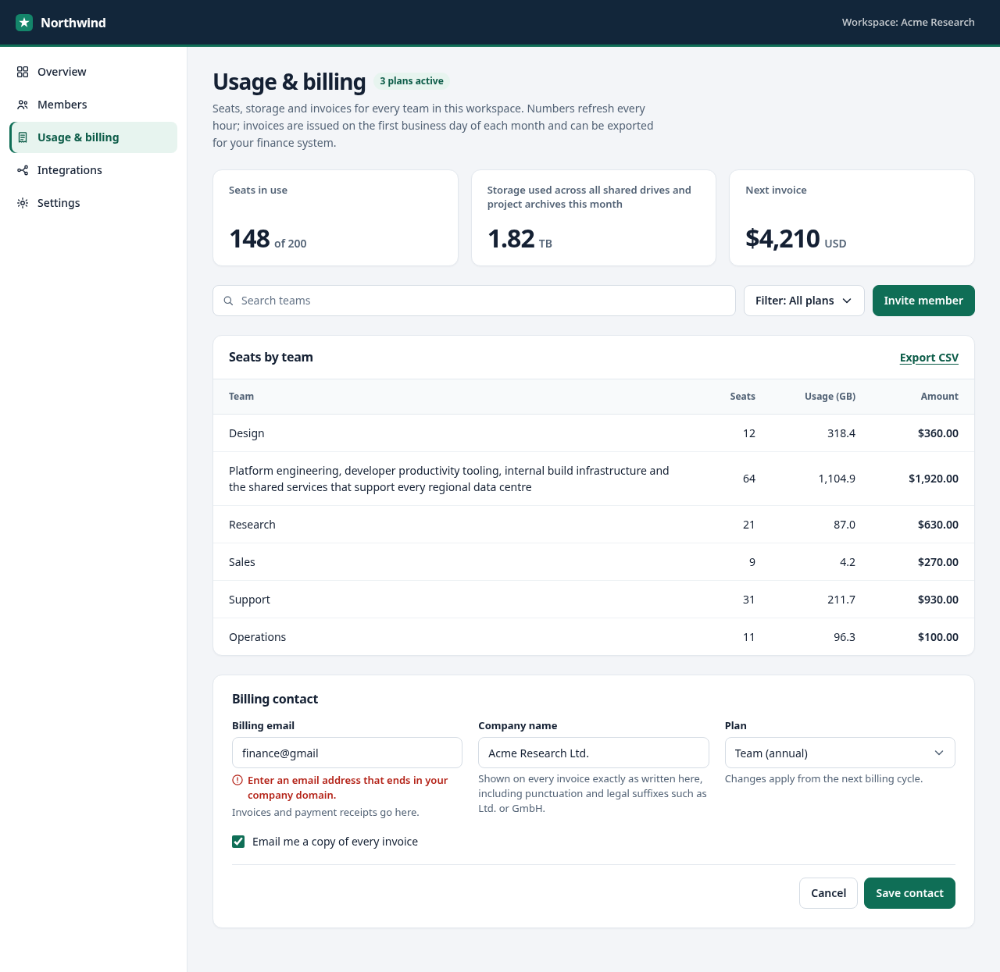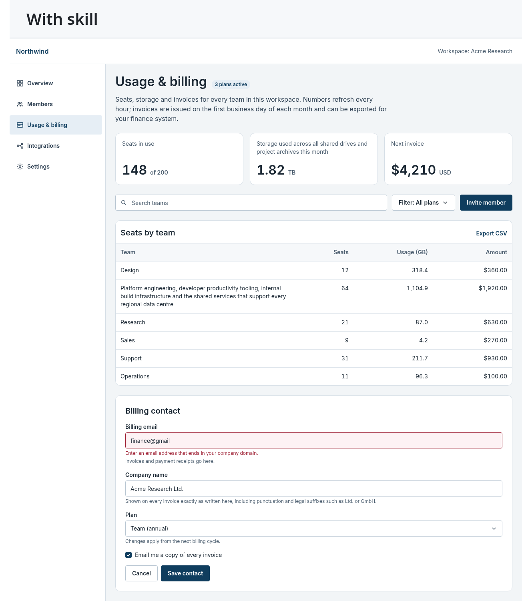

They look similar at a glance. That's the point: the difference is a badge 6.3px off the baseline, numbers 10.5px below the line they belong to, 6px gaps and fractional line-heights. Small on their own, and all of it adds up. Close-ups below.

## Side-by-side

Round 3 pages at 1280px, re-rendered in headless Chromium. Left: without the skill. Right: with it. Every crop is the same size as its partner, and the overlays use one key: gray dashed lines are the reference, soft violet is the measurement. A solid violet line with a filled tag is off; a dashed violet line with an outlined ✓ tag is aligned or on scale.

**1. Badge on the title baseline.** Without the skill, the "3 plans active" chip sits 6.3px above the heading's baseline. With it, the chip shares the heading's baseline exactly (0.0px).

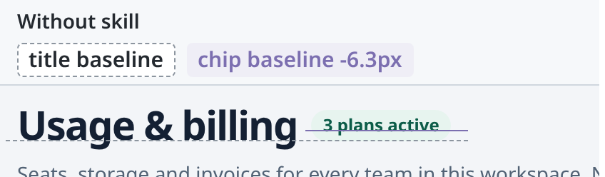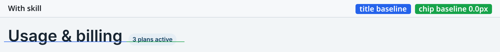

**2. Numbers next to a wrapped name.** Without the skill, vertically centered cells push the numbers 10.5px below the first line of a two-line team name. With it, top-aligned cells keep the numbers on the first line (0.0px).

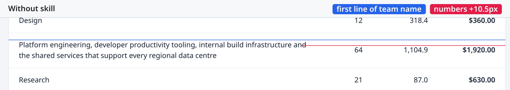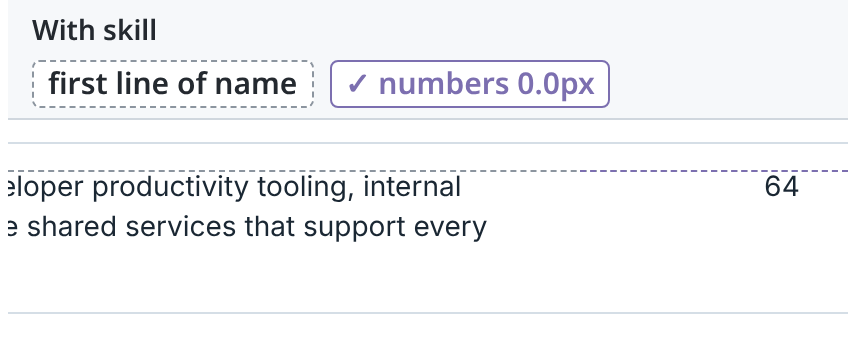

**3. Form gaps on the scale.** Without the skill, label to field and field to message are both 6px, which is off the 4px scale. With it, both gaps are 4px, a `--space-*` token.

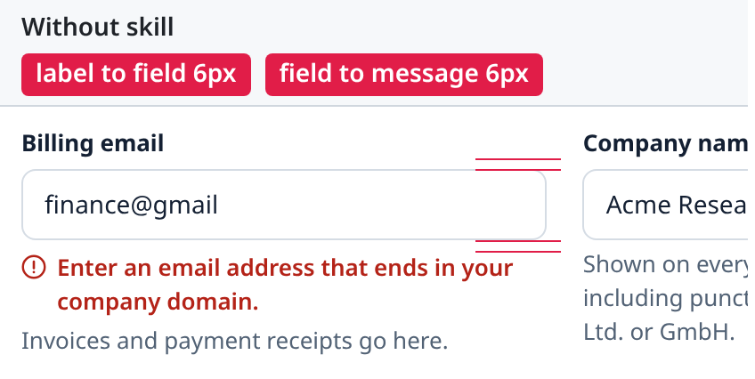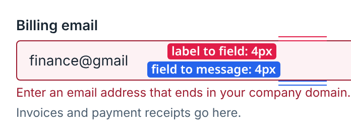

**4. Line-heights on the grid.** Without the skill, a unitless `1.55` gives the intro 21.7px lines, so every line after the first drifts off the 4px grid. With it, the intro is 16px/24px and every line lands on the grid.

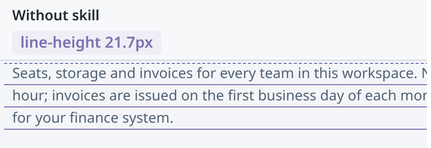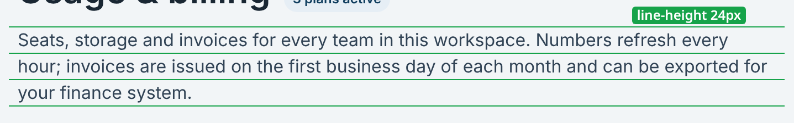

**5. Popover offset.** Without the skill, the filter menu opens 6px below its trigger, which is off the 4px scale. With it, the menu opens 8px below, the `--popover-offset` token.

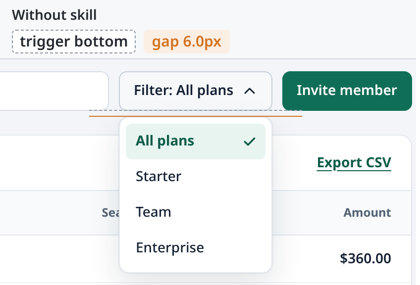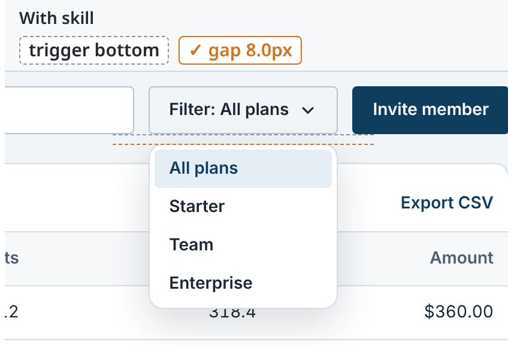

None of these is dramatic on its own, and that's the trap: each one is easy to eyeball as "fine", and an agent that only looks at screenshots will happily call it done.

## Side-by-side: an A4 print guide

The same treatment for the print example (fictional text; one A4 sheet is 794px wide), made from the live site with `node scripts/make-compare.mjs`. Left: without the skill. Right: with it. The overlay key is the one above.

**6. Paired terminals.** Without the skill, a wrapped label starts the right-hand terminal 30.0px lower than its partner, and the two end 7.0px apart. With it, both terminals share top and bottom (0.0px).

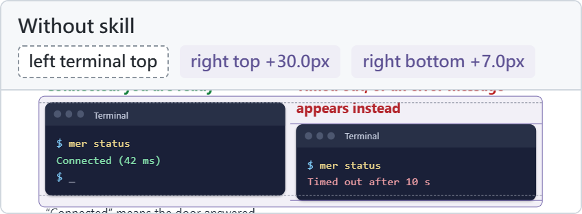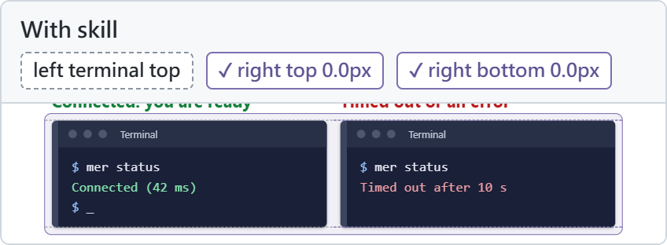

**7. No stub last line.** Without the skill, a wrapped sentence leaves a last line only 4.1em wide, a couple of words. With it, the same paragraph ends on a 15.7em line.

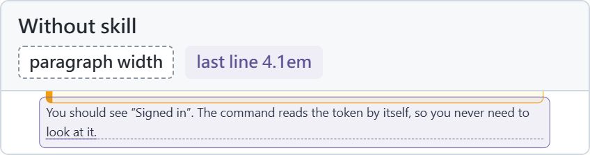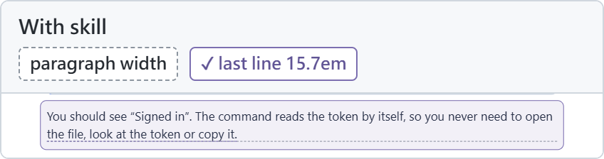

**8. One text-left.** Without the skill, table text starts 11.7px left of the text in the boxes beside it. With it, tables, lists, boxes and terminals all start text on one 24px inset.

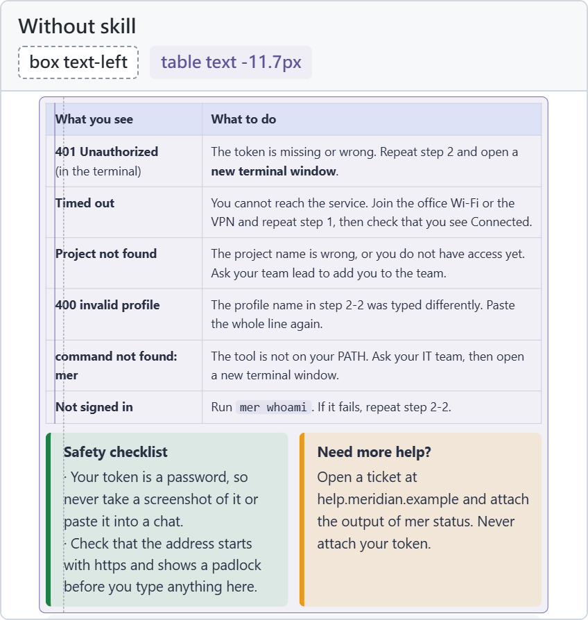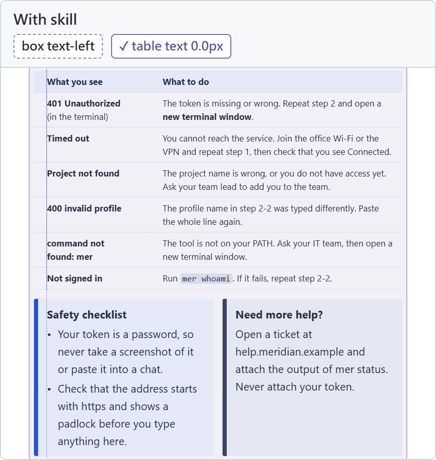

**9. A type scale.** Without the skill, the guide sets text in 9 sizes, with steps from 1.03x to 1.40x. With it, five sizes on the 4px grid, each step between 1.20x and 1.33x.

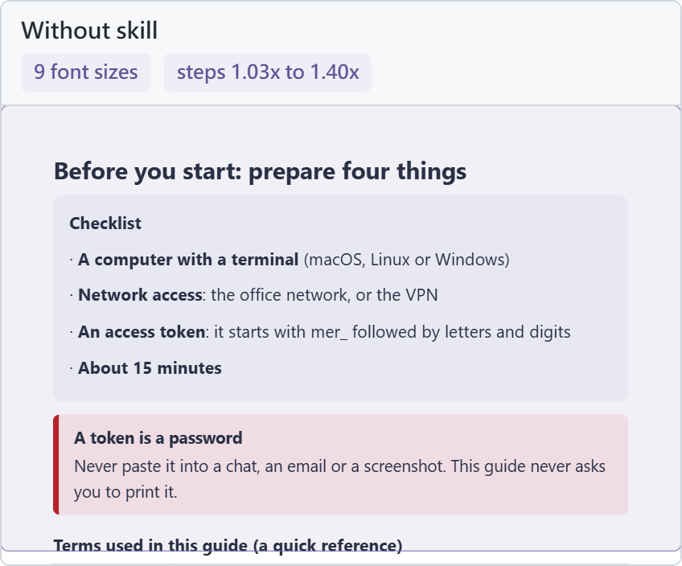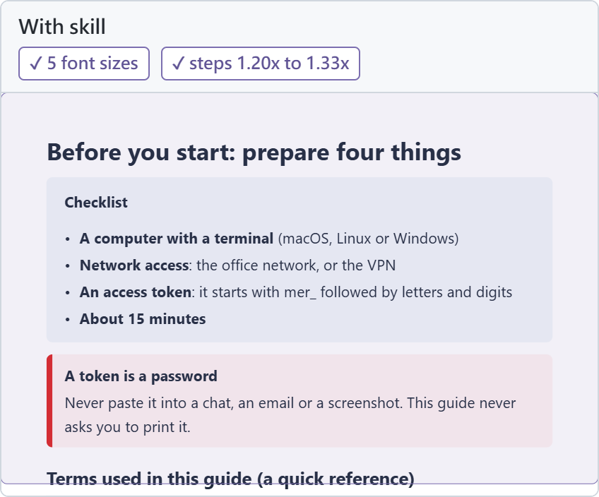

**10. A restrained palette.** Without the skill, the guide draws on 25 colours, including amber, which is outside the palette. With it, 19 colours in four hue families, all inside the palette.

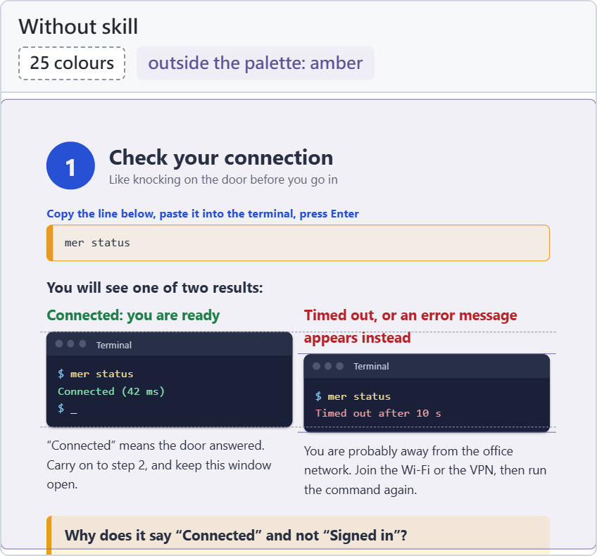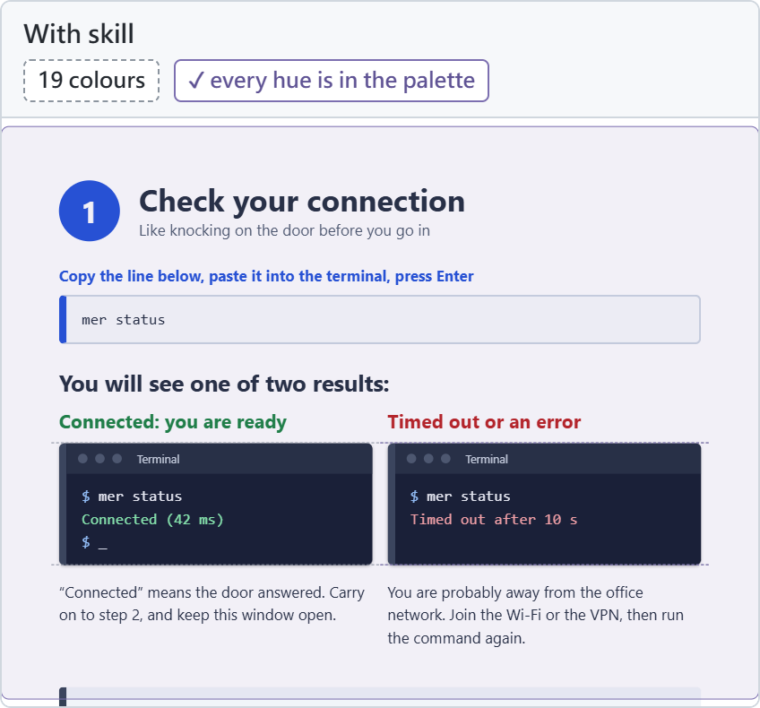

## FAQ

**Will this make my design pretty?** No. It makes it *aligned*. Taste is still your job. This skill makes sure nothing is quietly off.

**Can I change the scale?** Yes. Edit `tokens.css`; the lint reads token values from it.

**Isn't this a bit much for one pixel?** Yes. That's the whole idea.

**Does it work for PDFs and slides?** For anything you can render as HTML. Check the HTML in a browser, then print it to PDF. See [Printed documents](#printed-documents-a4-pdf).

**Which rules are only for CJK text?** In `typography-check.mjs`, the leading floor (1.5x) and the 40em line length apply to paragraphs that contain CJK characters, following the W3C notes on Chinese text layout. Latin text is not measured for either. Change `--prose-lh` and `--measure` if your script needs other numbers.

**What can't it see?** The inside of SVG illustrations, content drawn by CSS, and taste. In one run a list bullet written as a CSS escape rendered as ",2" and passed every check, so look at every page once the guards are green.

## License

MIT
